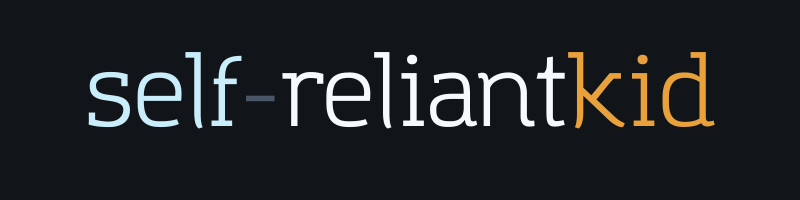

  
  
  
  

 

# Building is a craft!

---

## Who I am

I am **Senanu**, a Computer Science student at the **University of Ghana, Legon**.

I am a software engineer at Drizzle Hydration actively maintaining and building [Drizzle Shop](https://shop.drizzlelive.com) and the [Drizzle landing page](https://drizzlelive.com).

---

## Projects

### Farmer's Assistant:  

A farm monitoring system to help farmers track important farm metrics such as temperature, soil moisture, etc. and help farmers make better decisions.

### Exam Edge:  

A smart study app built for the University of Ghana Pharmacy School that enables students to study effectively using personalized learning plus peer tutoring instead of random generic study methods.

---

## Stack

**Frontend**

**Backend**

**Tools**

---

## Contributions
 
<picture>
  <source media="(prefers-color-scheme: dark)" srcset="https://raw.githubusercontent.com/self-reliantkid/self-reliantkid/output/pacman-contribution-graph-dark.svg">
  <source media="(prefers-color-scheme: light)" srcset="https://raw.githubusercontent.com/self-reliantkid/self-reliantkid/output/pacman-contribution-graph.svg">
  
</picture>
 
---
 
## GitHub Stats

  

---
